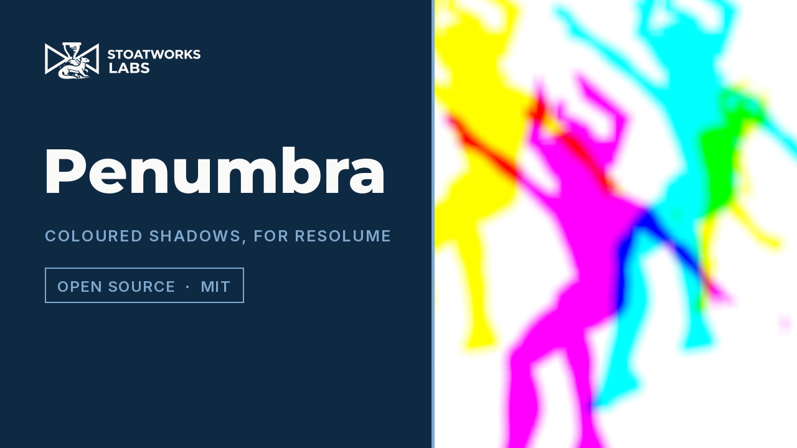

# penumbra

> **AI-assisted project.** This codebase was created with [Claude](https://claude.com/claude-code)
> (Anthropic), directed and reviewed by a human author. It has been loaded into Resolume
> Arena on macOS and on Windows and drew its shadows in both, on test clips and a stick
> figure (see [Status](#status)). Everything else below is
> measured by an offline harness, `putest`, that drives the real plugin class in a headless
> GL context with two inputs, at two rasters, on this Mac's GPU and again on Apple's software
> renderer, and reads the light straight off the plugin's float output. The shadows are
> checked against the geometry, not against screenshots. Block the red lamp and the screen is
> exactly cyan, the green lamp magenta, the blue yellow, all three black: **0** channel values
> wrong in 223,096 pixels; other lamp colours give the sum of the unblocked lamps to
> **4.2e-8**. Each shadow's soft edge is **18.0000**, **48.0000**, **54.0000** and
> **36.0000 px** wide where the similar-triangles closed form says 18, 48, 54 and 36. Every
> pixel agrees with the harness's own 3D ray cast through the occluder's plane to **2.1e-6**.
> With nothing in the way the screen comes back with **0** floats different. **37**
> deliberately wrong versions of the plugin and **29** one-character mutants of its GLSL and
> C++ are all caught. That each lamp lights the screen evenly, that lamps are square, and that
> the person is a flat cut-out at one distance are **assumptions**: see [Status](#status).

Coloured shadows, for [Resolume](https://resolume.com) Arena and Avenue, as an FFGL
**mixer**, **SW Penumbra**: three coloured lamps light a white screen with your clip printed
on it, and someone stands between them and the screen. Set it as the blend mode of the layer
that holds the person (a keyed performer, the hub's person mask, any clip with alpha), over
the layer that holds the clip.


<sub>The plugin on its defaults, rendered by `putest`, the offline harness, not captured
from Resolume, on 16 November 2026: the harness's figure as the occluder, a white screen
(`--input-a white --size 1280x720`). Red, green and blue lamps; the blue lamp's shadow is
yellow, the red lamp's cyan, the green lamp's magenta, and where two shadows cross only the
third lamp's light is left.</sub>


<sub>The same defaults on two of Resolume's bundled demo clips, through `putest --pipe` at
1280×720: `NoHopeJustFear_44` as the screen and `Metalive_01`, a clip with alpha, as the
occluder, each at 2 s.</sub>

<!-- downloads:start -->

## Download

**[v0.1.0](https://github.com/stoatworks-labs/penumbra/releases/tag/v0.1.0)** — prebuilt for macOS and Windows. Pick your platform:

<details>
<summary><b>macOS</b> — Universal (Apple Silicon + Intel)</summary>

| Build | Download | Size |
| --- | --- | --- |
| Universal (Apple Silicon + Intel) · .dmg disk image | [`penumbra-0.1.0-macos-universal.dmg`](https://github.com/stoatworks-labs/penumbra/releases/download/v0.1.0/penumbra-0.1.0-macos-universal.dmg) | 221 KB |
| Universal (Apple Silicon + Intel) · .zip archive | [`penumbra-macos-universal.zip`](https://github.com/stoatworks-labs/penumbra/releases/latest/download/penumbra-macos-universal.zip) | 179 KB |

</details>

<details>
<summary><b>Windows</b> — x64</summary>

| Build | Download | Size |
| --- | --- | --- |
| x64 · .exe installer | [`penumbra-0.1.0-windows-x86_64-setup.exe`](https://github.com/stoatworks-labs/penumbra/releases/download/v0.1.0/penumbra-0.1.0-windows-x86_64-setup.exe) | 248 KB |
| x64 · .zip archive | [`penumbra-windows-x86_64.zip`](https://github.com/stoatworks-labs/penumbra/releases/latest/download/penumbra-windows-x86_64.zip) | 117 KB |

</details>

All builds, checksums and release notes: [github.com/stoatworks-labs/penumbra/releases](https://github.com/stoatworks-labs/penumbra/releases).

macOS builds are signed and notarised and open normally. The Windows builds are unsigned, so SmartScreen warns once.

<!-- downloads:end -->

## Video

[](https://www.youtube.com/watch?v=9OlUl-H90OA)

## The one idea

**Each point of the screen shows the sum of the lamps it can see.**

Three square lamps stand in a plane parallel to the screen; the person stands in another
parallel plane, a fraction k of the way from the screen to the lamps. With source, occluder
and screen in three parallel planes, the part of a lamp a screen point can see is a
convolution: the lamp's shape, scaled by similar triangles, slid across the occluder's
silhouette (Soler and Sillion, SIGGRAPH 98, §3.1). With g = k/(1 − k), lamp i's shadow is
the silhouette **moved by −Lᵢ·g**, so a lamp to the right throws its shadow left, and
**blurred by a square of side sᵢ·g**, the lamp's own size seen through the occluder. How far
the lamps are from the screen drops out; only k matters.

A square lamp makes that blur a box, and a box over the silhouette is a handful of lookups
in a summed-area table: four for whole texels, sixteen when its edges fall between them. The silhouette arrives as 8-bit alpha, so the table holds it as
integers and sums them in 32-bit unsigned arithmetic, whose wrap-around GLSL defines: every
box sum is exact. The shadows cost the same at every Distance and lamp size, so there's no
quality control.

The screen is lit in linear light, white-balanced to itself: wherever no lamp is blocked the
light is exactly 1 and the clip comes back unchanged; under a shadow each channel keeps the
share of the light its unblocked lamps give it.

## What falls out

None of this is drawn. It's three lamps and someone in the way.

- **Red, green and blue light give cyan, magenta and yellow shadows.** Block red and the
  screen keeps green and blue. Where two shadows cross, only the third lamp is left: red,
  green or blue. The Exploratorium's Colored Shadows exhibit is this, on a wall.
- **Black only where all three lamps are blocked**, and with Room Light up, never quite
  black.
- **The shadows part, and their edges soften, as the person steps towards the lamps.** Both
  go as g: the shadows separate by |Lᵢ − Lⱼ|·g and each edge is sᵢ·g wide. At the screen
  (Distance 0) all three shadows are the silhouette, hard and black.
- **Thin things lose their shadow's core first.** A bar narrower than the penumbra has no
  umbra at all; its darkest point lets through 1 − a/(s·g) of the lamp. An arm's shadow goes
  pale long before the body's does.
- **Corners are the product of their edges.** Where two edges of the silhouette meet, the
  shadow is the two ramps multiplied, the square lamp's signature.
- **Lamps of any colour.** Amber, teal and violet lamps make the same structure in other
  colours; two white lamps make grey shadows; a lamp turned to black is gone, shadow and
  all.
- **The clip untouched wherever nobody stands**, to the bit, alpha included.

## Controls

| Group | |
| --- | --- |
| **Light** | Linear Light (on: lamps add and the clip is lit in linear light; off does the same arithmetic on gamma-encoded values. Arena hides it), Room Light (white light nobody blocks, 0–1 of one full white lamp: the floor under every shadow). |
| **Occluder** | Opacity (the occluder's opacity; Arena puts the layer's fader on it), Occluder (Alpha, Luma: which part of the layer is the person), Distance (how far from the screen the person stands, as a fraction k of the way to the lamps, 0–0.9). |
| **Lamp 1, 2, 3** | the colour (a picker; its level is the lamp's brightness), X (−2 to 2 screen heights) and Y (−1 to 1), the lamp's place in its plane, and Size (the square lamp's side, 0–0.5 screen heights; 0 is a point and a hard shadow). |
| **Screen** | Screen (As Is, On White), View (Picture, Light: the light on the screen as if the clip were white, for setting up). |

**The defaults** are a red, a green and a blue lamp in a triangle, at (−0.45, −0.15),
(0, 0.3) and (0.45, −0.15) screen heights, each 0.05 screen heights square, with the person
0.35 of the way to the lamps (g = 0.54), no room light, the occluder's alpha as the person
and the clip's own alpha as the output's. The triangle makes the three shadows part in three
directions. The Distance was chosen on Resolume's demo clips (below).

**The person.** Without the hub, any layer's alpha is the occluder: a keyed performer, a clip
with alpha, text. The hub's person mask arrives as a Syphon, Spout or NDI source; if it
comes as white on black with no alpha, set Occluder to Luma. With Occluder on Alpha, an
opaque white-on-black mask is a wall: it blocks everything. The layer's own colours are never
drawn: in a room the audience sees the person, not their shadow's mask.

**Output alpha**, decided:

- **As Is** (the default): the output's alpha is the clip's. A shadow is less light on the
  screen, not less screen, so where the clip is transparent the output is transparent and no
  shadow shows there. The occluder's alpha never reaches the output.
- **On White**: the clip printed on a white screen (composited over white, premultiplied, in
  gamma space as Arena composites), then lit. Opaque everywhere; where the clip is
  transparent the coloured shadows fall on white.
- **View Light**: the light alone, opaque.
- In every mode, a channel no shadow reaches is the input's own value, never a decode and
  re-encode of it: a red lamp's shadow leaves the clip's green and blue channels to the bit.

## Status

**v0.1.0, 18 November 2026, and early days.** It has been loaded into Resolume Arena on
Windows and on macOS, and drew its shadows in both (below), but only over a white clip with
a stick figure in front: never with a keyed performer or a camera mask, never through a
show. The macOS build is Developer ID-signed and notarised. `oxbow probe` reads the bundle
as a host does (`SW Penumbra` / `PU01` / **mixer**, two inputs, parameter 0 Linear Light, a
standard parameter named Opacity), and `oxbow selftest`, an effect host that hands the
plugin one input, is refused on its first frame, as a mixer must refuse it. There's a
[user guide](docs/USER-GUIDE.md) and a [browser demo](#browser-demo), but no OpenFX port and
no presets.

### In Resolume

The fleet's Arena gate cannot gate a mixer, so SW Penumbra was mounted by hand over Arena's
REST API and read through its own log, on 18 November 2026.


<sub>SW Penumbra on its defaults inside Resolume Arena 7.27.1 on Windows, software
rendering, from Arena's composition snapshot over REST: a white still on layer 2, and a
red stick figure with alpha on layer 3, whose Blend Mode is SW Penumbra. The figure's own
colour is never drawn.</sub>

- **Windows: Arena 7.27.1 on win-lab, software rendering (llvmpipe, no GPU)**, the DLL
  from a `release.yml` run of this source, which `tools/wincheck.ps1` had loaded as a host
  does (PU01, mixer, 30 parameters). Arena's log registers `'SW Penumbra' uid: PU01
  category: 2`, and it is offered in a layer's Blend Mode list (and in its transition
  list). Mounted as layer 3's Blend Mode, **29 of the 30 parameters are shown, and the
  missing one is Linear Light**, index 0, parked there for that reason. Setting the layer's
  opacity to 0.2, 0.85, 0.5 and 1.0 reached the plugin as **Opacity** at exactly those
  values (its log, frames 19, 28, 37 and 46), and a REST write of 0.15 to the mixer's own
  Opacity read back 1.0 and never reached it: **Opacity is the layer's fader.** Both inputs
  arrived padded, 1280×720 in 1280×768 textures, the case `--mixer` tests. Arena's
  composition snapshot showed the shadows: the three coloured figures on the defaults, one
  hard black silhouette at Distance 0, the shadows parted at 0.6.
- **As a layer transition** (4 s, Arena 7.27.1) it ran its own instance; its Opacity ramped
  from 0.001 to 0.987 in 17 frames and never reached 1, and then the layer showed the new
  clip on its own. So as a transition SW Penumbra ends with a jump, from the old clip with
  the new one's shadows on it to the new clip. It is meant as a blend mode.
- **macOS: Arena 7.29.0 on an Apple M4 Max**, a local universal build of the same source
  (ad-hoc signed, not the notarised download): registered `PU01` category 2, 29 of 30
  parameters shown with Linear Light the one hidden, the fader reaching Opacity at 0.2,
  0.85, 0.5 and 1.0, the REST write overridden, inputs padded 1920×1080 in 1920×1088, and
  the composition snapshot showing the shadows.

Not measured in Resolume: its cost (on llvmpipe Arena ran at about 5 fps, which says
nothing about the plugin), a real performer, and any GPU but the M4 Max.

### Measured offline, on macOS

`tools/verify.sh` passes on this machine (Apple Silicon, macOS 26) against a fresh universal
Release build (16 November 2026). It runs every picture check at **two rasters**, 640×360
and 320×180, on the GPU and all of them again on **Apple's software renderer**. Every
tolerance is derived from something stated (float ULPs of a coordinate, a counted number of
roundings, GLSL 4.10's `pow` budget), not fitted to the GPU; `AGENTS.md` lists them. What it
establishes:

| check | result |
| --- | --- |
| `--colour` | a rectangle and three lamps placed so all eight regions appear (none, each lamp, each pair, all three blocked): with the default primaries every region is **exactly** cyan, magenta, yellow, red, green, blue or black, **0** channel values wrong in 223,096 pixels (55,884 at 180p), Linear Light on and off; amber/teal/violet, two whites and a black lamp, and unequal levels with Room Light 0.3 each give (R + the unblocked lamps)/(R + all) to **4.2e-8**, bound 1.1e-6 |
| `--penumbra` | a straight edge's shadow is a straight ramp **18.0000**, **48.0000**, **54.0000** and **36.0000 px** wide for k/size 0.2/0.2, 0.4/0.2, 0.6/0.1 and 0.2/0.4, where s·d/(D − d) is 18, 48, 54 and 36 px (bound 0.018 px; at 320×180 each is half as wide, as it should be); straight to 1.6e-7. A 21 px bar under a 108 px penumbra has no umbra: darkest **0.805556**, 1 − a/w = 0.805556. A corner is the product of its two ramps to 2.3e-7. Every pixel and channel of a scene of six blocks, three lamps of different sizes and colours, Opacity 0.8 and Room Light 0.2 matches the harness's 3D ray cast (lamps at an odd D = 7.3 screen heights) to **2.1e-6**, bound 0.0015 |
| `--parting` | at k = 0 all three shadows are the occluder, hard (**0** values off); at k = 0.2 and 0.5 each lamp's shadow is centred on the occluder moved by −Lᵢ·g, in x and y, to **6.9e-6 px**, bound 0.006 |
| `--unchanged` | nothing blocked gives the screen **bit for bit**: a clear occluder, an opaque one at Opacity 0, every shadow thrown off the frame, odd lamp colours with Room Light, Linear Light off, float Dest with partial alpha and 8-bit Dest padded at the output's size, all **0** floats different; On White is rgb + (1 − a) to the bit |
| `--alpha` | As Is: the output alpha is the clip's, **0** different, shadowed or not; the occluder's alpha (0.5 or 1) changes the colour, never the alpha; a shadow on partial alpha is encode(decode(rgb/a)·L)·a to 1.5e-7, bound 1.2e-5; On White is opaque everywhere; Luma on a grey-on-black opaque mask renders the same bytes as Alpha on the same greys in alpha |
| `--linear` | one of three white lamps blocked gives encode(decode(g)·⅔) across the sRGB knee to 4.1e-8 (Linear Light off: g·⅔ to 7.5e-9); a lamp picked at (1, 0.5, 0) shares decode(0.5) = **0.2140** of the green with a white lamp, light 0.8237 where it is blocked |
| `--opacity` | 1 − light is Opacity times the blocking at 0.25 and 0.5 to 3e-8, in linear light, not a gamma-space crossfade; at 0, the screen byte for byte |
| `--mixer` | null, zero and one input, null or zero-sized inputs and a zero viewport each return FF_FAIL and leave the plugin working; Dest 200×120 of 256×256 and Src 96×70 of 128×128 into 320×180 and 640×360, both padded in opaque magenta: **0** padding pixels reach the picture or cast a shadow; at Distance 0 a block's hard shadow is black on exactly the 25,600 output pixels that map into it, every other pixel the screen to the byte; after a frame the host's textures, program, framebuffer, viewport, blend and clear colour are back |
| `--resize` | Src and output sizes changed mid-run: the next frame is a fresh instance's, **0** bytes different, four sizes |
| `--names` | 30 parameters, within FFGL's 16 bytes, unique, the About block last; index 0 is Linear Light, on; Opacity is a standard parameter |
| `--pipe` | a clear Src gives Dest back byte for byte; 3 Dest frames over 2 Src frames give 2 out, 2.5 frames give 2; cues ramp Opacity and step View; a bad cue or `--set` exits 2; a closed stdout (`\| head -c 1`) exits 1, not 141 |
| negative controls | **37** deliberately wrong versions built into the real plugin (the shadows multiplied instead of summed, thrown towards their lamps, blurred by the lamp scaled to the occluder's plane, read at the pixel's corner, the padding occluding, alpha from the occluder, and so on), **37** caught |
| mutation | **29** one-character mutants of the shipped GLSL and C++, **29** caught |
| `tools/sweep.py` | all **25** controls change the picture (Screen with a clip that has alpha) |
| shaders | all 4 compile through `glslc`, not merely through Apple's driver |
| the bundle | universal (`x86_64 arm64`), exports `plugMain`, ad-hoc signs; `oxbow` reads its name, id, type, inputs and parameter 0 |

**Render cost.** Wall-clock with `glFinish` either side, the mean of 30 frames after 60 of
warm-up, Dest and Src at the output's size, from verify.sh's run on 16 November 2026 on an
M4 Max shared with other builds: **0.204 ms** at 720p, **0.407 ms** at 1080p (2.4% of a
60 fps frame) and **2.38 ms** at 4K, at the defaults; at the biggest boxes the controls allow
(Distance 0.9, every lamp 0.5) 0.205, 0.412 and 2.39 ms. Lamp size and Distance cost nothing,
because a box of any size is the same 16 lookups. Earlier runs the same day, with a 5-frame
warm-up and the machine busier, read up to 0.61 ms at 1080p. 4K costs 5.8 times 1080p for 4
times the pixels; why has not been looked into. macOS figures only, on one GPU.

**Resolume's demo clips.** Frames at 2 s from the bundled clips in Arena's `media` folder
(Shop74's and the AV set, DXV at 1280×720, many with alpha) were paired through `putest
--pipe` and judged by eye on contact sheets: six of the clips with alpha (BattleWeapon_Tank_09,
Metalive_01, Trinity_09, Ethnik2, OrganicMotions_06, Galactucity_21) as the occluder over the
three brightest opaque clips (NoHopeJustFear_44, Beat_001, IntoTheGlow_21), and four of them
over two screens at Distance 0.2, 0.35 and 0.5. The Distance default came from that: at 0.2,
a half-frame occluder throws one black hole with thin coloured rims; at 0.35 all seven colours
show around a smaller core; at 0.5 a thin outline, Trinity's rings, blurs away. Most of the
demo clips are dark, and a shadow on a dark screen is dark: the light multiplies the clip, and
a clip that's nearly black stays nearly black. On White is the answer for a clip with alpha. A
strongly coloured screen shows only the shadows of the lamps it reflects: on a red screen only
the red lamp's shadow is visible.

### Not established

- **Resolume in a show.** Mounted on test pictures only (above): never a keyed performer
  or a camera mask, never a whole show, never timed inside Resolume.
- **Brightening.** There is none. The lamps light the clip, so a shadow on a dark clip is
  faint and most of Resolume's demo clips are dark. A gain would not be light; whether the
  plugin should offer one anyway is open.
- **The hub.** Its person mask has never been fed in. Whether it arrives with alpha or as
  white on black is the hub's to decide; the default reads alpha.
- **Each lamp is assumed to light the screen evenly**: no inverse square, no cosine, no
  form factor. Only which part of each lamp a point can see varies. Soler and Sillion
  separate the two the same way, as an approximation that holds when the lamp is small next to
  its distance.
- **Square lamps only**, square to the screen. A round lamp's edge has the same width but a
  different profile, and a summed-area table can't do a disc in constant time.
- **The person is flat, at one distance.** No depth per pixel: a mixer has two inputs, both
  spoken for, and an occluder that isn't flat isn't a convolution. The spec gives the
  reasons and what a v0.2 would add.
- **The occluder is 8-bit**, held as up to 255 levels (fewer only above 4096×2160, so the
  table fits 32 bits).
- **Room Light is a uniform floor**: the person doesn't block it.
- **Other GPUs.** Run on one Apple GPU and Apple's software renderer only.

## Browser demo

**<https://penumbra-demo.stoatworks-labs.com/>** is SW Penumbra in a web page: every control
with its own name, group and default; a white screen, one of the kit's generated clips or a
picture of yours (decoded in the page, never uploaded) as the screen; and putest's stick
figure, still or gently swaying, as the person. The shaders are the plugin's own GLSL,
spliced unedited (`demo/tools/check_shaders.py`, run by `tools/verify.sh`). What runs them
(the R32UI tables and radix-16 prefix passes, the lamps' shares and boxes, every conversion)
is a JavaScript port, and `demo/tools/crosscheck/` renders it and `putest` from the same
frames: in 17 cases at 640 × 360 and 1280 × 720, every pixel is the plugin's. It is a demo,
not the plugin, and says what it leaves out: the person is a generated figure, not a keyed
performer, and the page has never been compared on another GPU.

## Build

macOS (universal: Apple Silicon and Intel), from a checkout with its submodule
(`git clone --recursive https://github.com/stoatworks-labs/penumbra`, or
`git submodule update --init --recursive` in an existing clone):

```bash
cmake -B build -DCMAKE_BUILD_TYPE=Release
```

```bash
cmake --build build
```

```bash
cmake --install build
```

The last one copies `Penumbra.bundle` into `~/Documents/Resolume Arena/Extra Effects`.
Restart Arena and it is in a layer's Blend Mode list as **SW Penumbra**.

Windows needs Visual Studio 2022 and vcpkg (for GLEW); see `.github/workflows/ci.yml`,
which builds it on every push with no warnings, and `release.yml`, whose
`tools/wincheck.ps1` loads the DLL as a host does.

## Building and testing

```bash
OXBOW=/path/to/oxbow tools/verify.sh
```

That's the whole lot: shader hygiene and `glslc`, a fresh universal build with no warnings,
every check at two rasters on the GPU and on the software renderer, the pipe, the bundle's
architecture, plist and ad-hoc signature, a host's view of it through `oxbow`, the mutants,
the sweep for dead controls and the render cost. It needs a built `oxbow` and fails without
one. `CLAUDE.md` lists the checks one by one.

Render a frame of your own:

```bash
./build/putest --out /tmp/penumbra.png --input-a white --set "Distance=0.6"
```

Or put a clip through it, the screen on stdin and the occluder from a file:

```bash
./build/putest --pipe --size 1280x720 --pipe-src person.rgba < screen.rgba > out.rgba
```

## License

MIT. See [LICENSE](LICENSE) and [ATTRIBUTIONS.md](ATTRIBUTIONS.md).

<!-- attributions:start -->
This project is built on other people's work — see [ATTRIBUTIONS.md](ATTRIBUTIONS.md).
<!-- attributions:end -->
